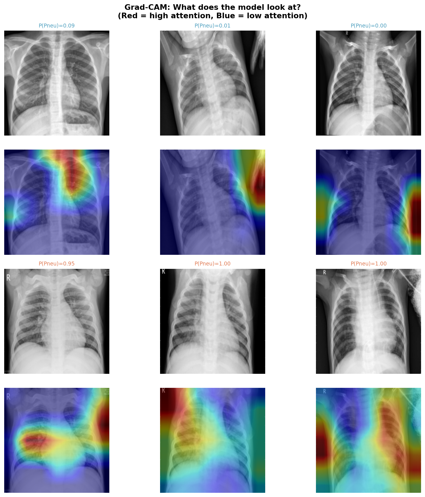

# Chest X-Ray Pneumonia Classification
### Deep Learning + Grad-CAM Interpretability

A end-to-end pipeline for binary classification of chest X-rays (Normal vs Pneumonia) using PyTorch. Includes a baseline CNN trained from scratch, ResNet-50 fine-tuning with two-stage transfer learning, threshold optimization, and Grad-CAM visualizations to verify clinical validity.

---

## Results

| Metric | Baseline CNN | ResNet-50 (threshold=0.94) |
|---|---|---|
| Accuracy | 80.0% | **90.4%** |
| AUC-ROC | 0.918 | **0.965** |
| Sensitivity | 95.1% | **98.7%** |
| Specificity | 54.7% | **76.5%** |
| F1 Score | 0.856 | **0.928** |

> **Threshold = 0.94** was selected over the default 0.50 because in pneumonia screening, missing a true case (false negative) is clinically more dangerous than a false alarm. At this threshold, only 5 out of 390 pneumonia cases are missed.

---

## Grad-CAM — What does the model look at?



- **Normal X-rays (top two rows):** Heatmap is diffuse — no concentrated pathological focus
- **Pneumonia X-rays (bottom two rows):** Heatmap concentrates on lower lung fields and perihilar regions, consistent with consolidation patterns

The model attends to clinically relevant anatomy, not image artifacts or borders.

---

## Project Structure

```
chest-xray-classifier/
│
├── notebooks/
│   ├── 01_eda_and_preprocessing.ipynb    # Dataset analysis, DataLoader pipeline
│   ├── 02_baseline_cnn.ipynb             # 4-block CNN from scratch
│   ├── 03_resnet50_finetune.ipynb        # Two-stage ResNet-50 fine-tuning
│   └── 04_gradcam.ipynb                  # Grad-CAM interpretability
│
├── figures/
│   ├── class_distribution.png
│   ├── image_size_analysis.png
│   ├── baseline_training_curves.png
│   ├── baseline_confusion_roc.png
│   ├── resnet50_training_curves.png
│   ├── resnet50_confusion_roc.png
│   ├── threshold_tuning.png
│   └── gradcam_comparison.png
│
├── results/
│   ├── baseline_results.json
│   └── resnet50_results.json
│
├── app.py                                # Streamlit demo app
├── requirements.txt
└── README.md
```

---

## Dataset

[Chest X-Ray Images (Pneumonia)](https://www.kaggle.com/datasets/paultimothymooney/chest-xray-pneumonia) — Kermany et al., 2018

- 5,216 training images (1,341 Normal / 3,875 Pneumonia)
- 624 test images
- Binary classification: NORMAL vs PNEUMONIA

**Key challenge:** ~3:1 class imbalance in training set, addressed using `WeightedRandomSampler`.

---

## Methodology

### 1. Preprocessing
- Resize all images to 224×224
- Convert grayscale to 3-channel (required for ImageNet-pretrained models)
- Training augmentation: random horizontal flip, ±10° rotation, brightness/contrast jitter
- Original val split (16 images) merged back into train; stratified 80/20 re-split applied

### 2. Baseline CNN
- 4 convolutional blocks: Conv → BatchNorm → ReLU → MaxPool → Dropout
- ~400K trainable parameters, trained from random initialization
- Adam optimizer, lr=1e-3, 15 epochs

### 3. ResNet-50 Fine-tuning (Two-stage)
- **Stage 1 (epochs 1–5):** Freeze all ResNet weights, train only the new classification head (Linear → ReLU → Dropout → Linear). lr=1e-3
- **Stage 2 (epochs 6–15):** Unfreeze `layer4` + head, fine-tune with lr=1e-4
- This prevents early destruction of pretrained ImageNet features

### 4. Threshold Optimization
- Default threshold of 0.50 gave sensitivity=99.5%, specificity=60.7%
- Tuned to 0.94 → sensitivity=98.7%, specificity=76.5%, F1=0.928
- Tradeoff justified: in screening, false negatives (missed pneumonia) are more harmful than false positives

### 5. Grad-CAM Interpretability
- Hooks into `model.layer4[-1]` to capture activations and gradients
- Heatmaps confirm model focuses on lung parenchyma in pneumonia cases
- Failure case analysis: false positives tend to occur on X-rays with haziness or cardiomegaly

---

## Setup & Usage

### Install dependencies
```bash
pip install -r requirements.txt
```

### Run Streamlit app
```bash
streamlit run app.py
```

### Run notebooks
Open in Google Colab with T4 GPU. Download the dataset via Kaggle API (see Notebook 01).

---

## Requirements

```
torch>=2.0.0
torchvision>=0.15.0
streamlit>=1.28.0
Pillow>=9.0.0
numpy>=1.24.0
matplotlib>=3.7.0
scikit-learn>=1.3.0
```

---

## Key Design Decisions

| Decision | Choice | Reason |
|---|---|---|
| Primary metric | AUC-ROC + Sensitivity | Accuracy misleading with class imbalance |
| Class imbalance | WeightedRandomSampler | Keeps all data, reweights sampling |
| No vertical flip | — | Inverted chest X-rays are not clinically valid |
| Two-stage fine-tuning | Freeze → partial unfreeze | Prevents catastrophic forgetting of ImageNet features |
| Threshold = 0.94 | — | Optimizes sensitivity/specificity tradeoff for screening |

---

## Limitations

- Dataset contains only pediatric X-rays (Guangzhou Women and Children's Medical Center) — may not generalize to adult populations
- Binary classification only — does not distinguish bacterial vs viral pneumonia
- Specificity (76.5%) still leaves room for improvement; ensemble methods or larger backbones (ResNet-101, EfficientNet) may help

---

## Author

Mansi | M.Tech Bioengineering, IISc Bangalore  
GitHub: [@Mansi31-bytes](https://github.com/Mansi31-bytes) | HuggingFace: [Mansi3110](https://huggingface.co/Mansi3110)
