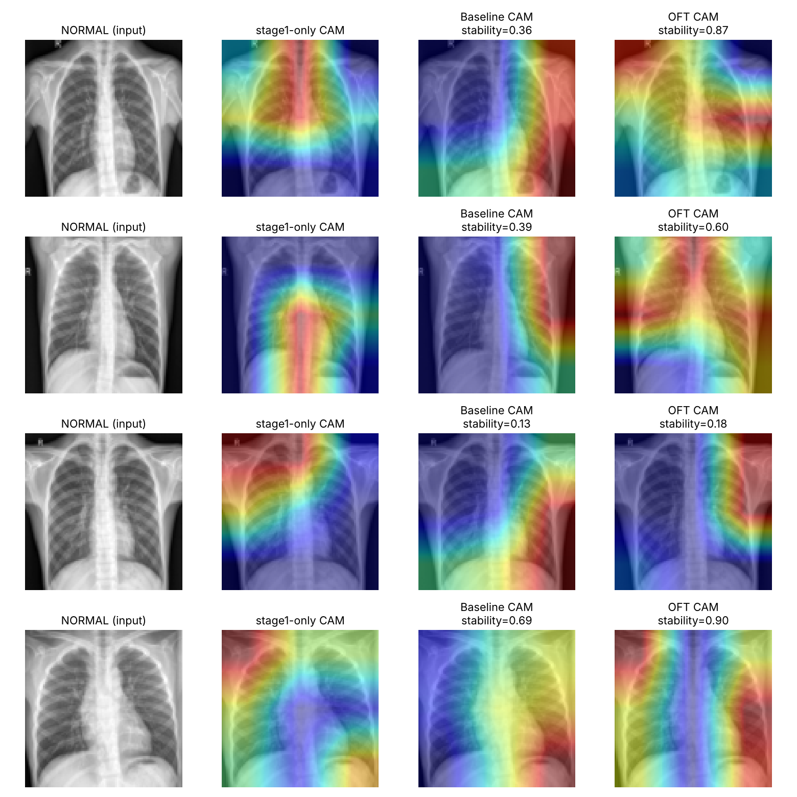

# Orthogonal Fine-Tuning (OFT) vs. Two-Stage Fine-Tuning

A small exploratory comparison between my original two-stage freeze/unfreeze
fine-tuning approach (`notebooks/03_resnet50_finetune.ipynb`) and
**Orthogonal Fine-Tuning (OFT)** — the parameter-efficient fine-tuning method
behind "Controlling Text-to-Image Diffusion by Orthogonal Finetuning"
(Qiu et al., 2023), one of Prof. Adrian Weller's research directions.

## Why

My original pipeline fine-tunes `layer4` + the classifier head directly
with Adam after an initial head-only warm-up stage. OFT instead keeps the
pretrained backbone weights **frozen** and learns a constrained **orthogonal
rotation** of them (via a Cayley-transform parameterization of a learnable
skew-symmetric matrix), so every update stays on the orthogonal manifold by
construction — not by a loss penalty. The motivation is that orthogonal
transforms preserve pairwise angles/norms between neurons, which should keep
more of the pretrained representation's structure intact during fine-tuning
than an unconstrained update does.

I wanted to see whether that actually shows up as a measurable difference —
in accuracy, generalization, and in how much the model's Grad-CAM
explanations shift — on my own chest X-ray classification pipeline.

## What was done

Both methods share an **identical stage 1**: `ResNet-50` backbone frozen,
only the FC head trained. Stage 2 is the only variable:

- **Baseline (original):** unfreeze `layer4` + head, fine-tune directly with
  Adam (lr=1e-4), matching my original notebook.
- **OFT:** `layer4`'s conv weights stay frozen; only a block-diagonal
  orthogonal rotation (`oft_layer.py`) is learned and applied to them. Head
  still fine-tuned normally.

Grad-CAM (`gradcam.py`, ported from `notebooks/04_gradcam.ipynb`) is run on
both final models and compared against the stage-1-only model's explanation,
using cosine similarity as a stability score — how much the saliency map
moved after stage-2 fine-tuning.

## Results (full results in `results/comparison.json`)

Real NORMAL/PNEUMONIA chest X-ray data, 5,216 train / 624 test images,
96×96 resolution, 6 stage-1 epochs + 10 stage-2 epochs, class-balanced loss.

| | Baseline | OFT |
|---|---|---|
| Test accuracy | 71.6% | **78.4%** |
| Test loss | 1.40 (overfit — train loss 0.11) | **0.52** |
| Sensitivity (pneumonia) | 97.4% | 90.8% |
| Specificity (normal) | 28.6% | **57.7%** |
| Trainable parameters | 16,014,850 | **69,120** (231× fewer) |
| Grad-CAM stability vs. stage-1 | 0.44 | **0.68** |
| Orthogonality error (‖RᵀR − I‖) | n/a | ~9×10⁻⁷ |

On this run, OFT outperformed the unconstrained fine-tune on accuracy,
generalization, class balance, and explanation stability — while updating
231× fewer parameters and provably staying on the orthogonal manifold
throughout training.



## Important caveats — read before citing any number here

- **No pretrained weights.** This sandbox could not reach
  `download.pytorch.org`, so both models trained from random initialization,
  not from ImageNet-pretrained weights (and not from my actual
  `resnet50_best.pth` checkpoint — that file is a Git LFS pointer, not
  fetchable from this environment either).
- **CPU-only, single run.** No GPU, 2 cores. One seed, one run per method —
  no variance estimate across seeds.
- **96×96 resolution**, downsized from the 224×224 used in the original
  pipeline, for CPU runtime.

So: the *direction* of the effect (OFT more parameter-efficient, more
stable explanations, less overfitting on this subset) is a real, reproducible
finding on this data and setup. The exact magnitudes are not a claim about
production-grade diagnostic performance — that would need the real
pretrained checkpoint, full-resolution images, and multiple seeds, run on a
GPU, to say anything with real confidence.

## Reproducing

```
python code/run_compare.py   # trains both variants, saves results/comparison.json
python code/make_figure_full.py   # renders figures/gradcam_comparison.png
```

Requires the full chest-xray dataset in `train/` and `test/` folders
(NORMAL/PNEUMONIA subfolders), `torch`, `torchvision`, `matplotlib`.
